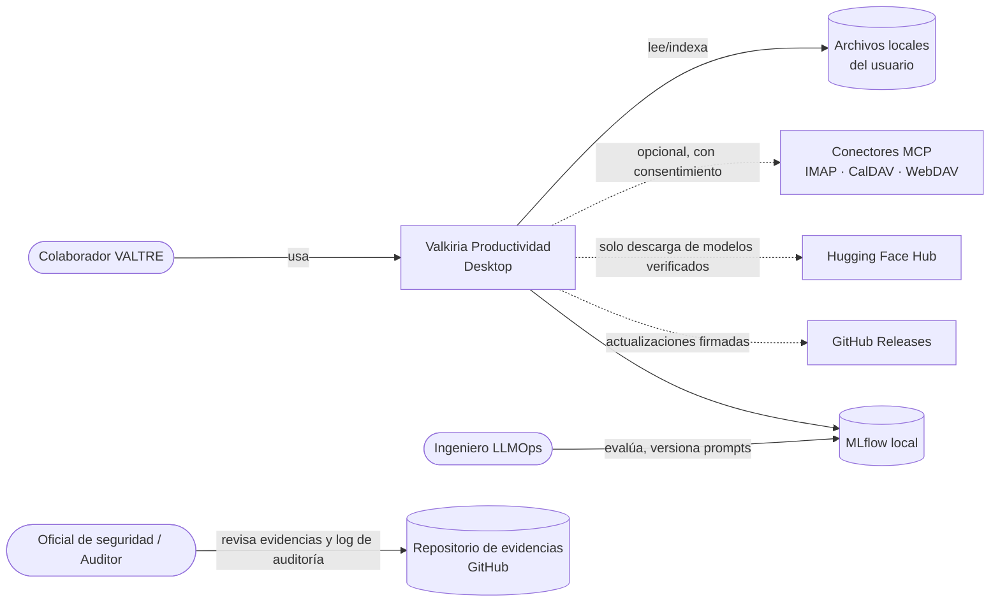
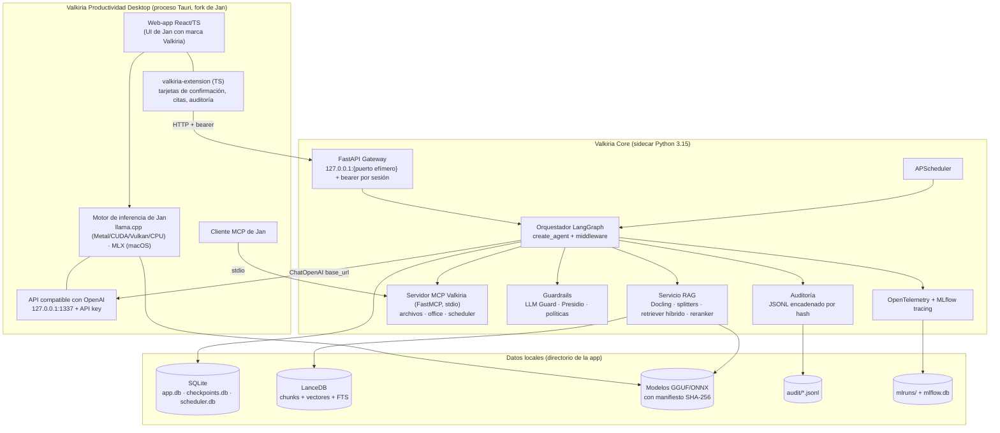
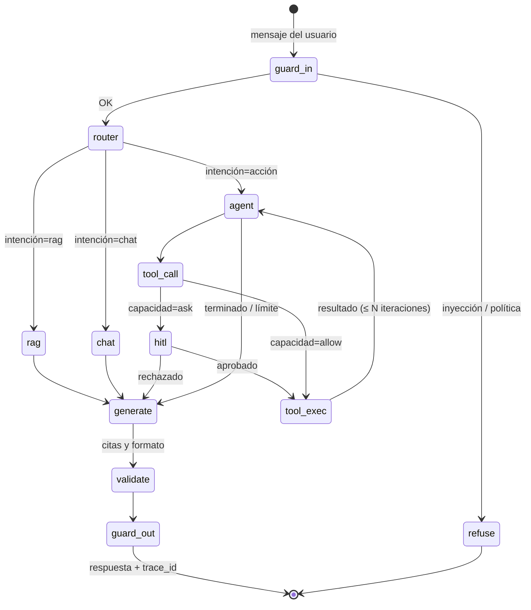
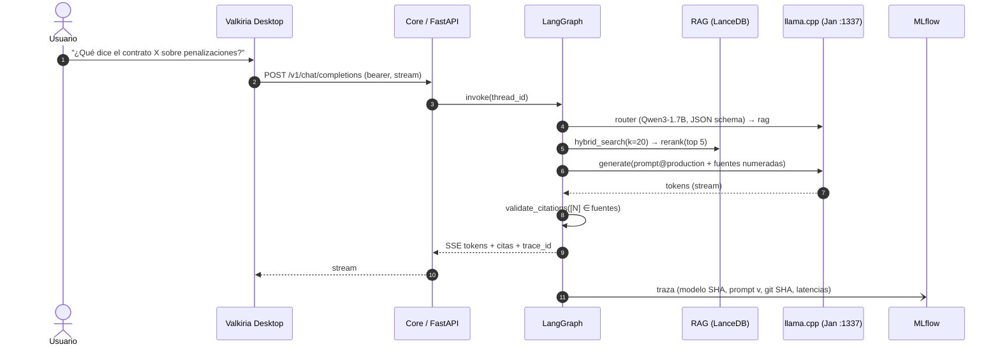
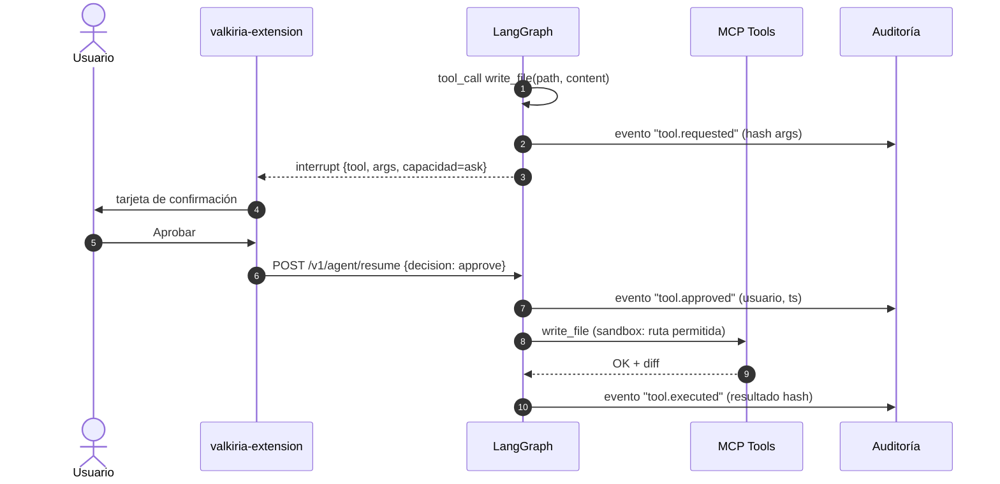

# 03 · Arquitectura de referencia: Valkiria Productividad

**Valkiria Productividad** es el asistente de IA de escritorio de **VALTRE**. Funciona 100 % en el equipo del usuario (macOS y Windows) con mini LLMs gratuitos, un frontend derivado de **Jan**, un backend en **Python 3.15** orquestado con **LangGraph/LangChain**, y **MLflow 3** como columna vertebral de LLMOps.

| Versión del documento | Estado | Decisiones vinculadas |
|---|---|---|
| 2.0 | Propuesta para revisión | [ADR-0001 a ADR-0012](adr/README.md) |

---

## 1. Atributos de calidad (prioridad)

| # | Atributo | Escenario medible |
|---|---|---|
| Q1 | **Seguridad y privacidad** | Ningún dato del usuario sale del equipo sin un consentimiento explícito registrado; 0 puertos escuchando fuera de `127.0.0.1` |
| Q2 | **Confiabilidad** | Si el backend se cae, se reinicia solo en ≤ 3 s y la conversación se reanuda desde el último *checkpoint* |
| Q3 | **Trazabilidad y auditoría** | Toda respuesta tiene un `trace_id` vinculado al modelo (SHA-256), la versión del prompt y el *git SHA*; toda acción con efectos queda en un log de auditoría encadenado por hash |
| Q4 | **Rendimiento** | Ver los objetivos de TTFT y tok/s en [02 · §5](02-revision-arquitectura-azure.md#5-presupuesto-de-memoria-máximo-32-gb) |
| Q5 | **Portabilidad** | La misma base de código produce instaladores firmados para macOS (arm64, x64) y Windows (x64) |
| Q6 | **Mantenibilidad** | Prompts, modelos y herramientas se cambian sin recompilar, con versionado y evaluación |
| Q7 | **Escalabilidad** | El mismo Valkiria Core se despliega en modo equipo (contenedores) sin cambiar el código de dominio |

## 2. Principios de diseño

1. **Local-first y privado por defecto:** red apagada salvo descarga de modelos y conectores autorizados.
2. **Arquitectura hexagonal** (puertos y adaptadores) en Valkiria Core: el dominio no conoce llama.cpp, LanceDB ni MLflow.
3. **Un solo motor de inferencia** (el de Jan), compartido por la UI y el agente, para no duplicar modelos en RAM.
4. **Mínimo privilegio:** cada herramienta declara su capacidad; el usuario decide entre Bloquear, Pedir confirmación o Permitir.
5. **Todo lo que influye en una respuesta está versionado:** modelo, prompt, configuración del grafo y datos de evaluación.
6. **Degradación elegante:** si falla el RAG, se responde sin contexto con un aviso; si falla el re-ranker, se usa la fusión RRF sola; si el modelo grande no cabe, se usa el del perfil Estándar.

## 3. Contexto (C4 nivel 1)



## 4. Contenedores (C4 nivel 2)



| Contenedor | Tecnología | Responsabilidad | Proceso |
|---|---|---|---|
| Valkiria Desktop | Fork de Jan v0.8.x (Tauri 2, React, TS) | UI, gestión y descarga de modelos, motor llama.cpp/MLX, cliente MCP | Principal |
| valkiria-extension | Extensión TS del sistema de extensiones de Jan | Proveedor "Valkiria Agent", tarjetas de confirmación (HITL), panel de fuentes, visor de auditoría | Dentro de la UI |
| Valkiria Core | Python 3.15, FastAPI, LangGraph, LangChain v1 | Agente, RAG, herramientas, guardrails, scheduler, auditoría y telemetría | Sidecar supervisado por Tauri |
| Servidor MCP Valkiria | MCP SDK de Python (FastMCP) | Exponer herramientas a Jan y al agente | Subproceso stdio |
| MLflow | MLflow 3 (SQLite + artefactos locales) | Trazas, Prompt Registry, evaluaciones, registro de modelos y configuraciones | Bajo demanda (UI) / en el proceso (cliente) |

## 5. Componentes de Valkiria Core (C4 nivel 3)

```
valkiria_core/
├── domain/                 # Entidades y reglas puras (sin dependencias externas)
│   ├── conversation.py     # Thread, Message, Citation
│   ├── documents.py        # Document, Chunk, Source
│   ├── permissions.py      # Capability, PermissionLevel, Decision
│   └── audit.py            # AuditEvent (hash, prev_hash)
├── ports/                  # Interfaces (Protocol)
│   ├── llm.py              # ChatModelPort, EmbeddingPort, RerankerPort
│   ├── vector_store.py     # VectorStorePort (upsert, hybrid_search)
│   ├── repository.py       # ThreadRepo, FileRepo, ProjectRepo
│   ├── tracing.py          # TracerPort
│   └── secrets.py          # SecretStorePort
├── adapters/
│   ├── llm_openai_compat.py   # ChatOpenAI(base_url=Jan) + structured output
│   ├── embeddings_fastembed.py
│   ├── lancedb_store.py
│   ├── sqlite_repos.py        # SQLAlchemy 2 + Alembic
│   ├── mlflow_tracer.py       # mlflow.langchain.autolog + tags de trazabilidad
│   ├── keyring_secrets.py
│   └── docling_parser.py
├── application/
│   ├── graphs/
│   │   ├── main_agent.py      # create_agent + middleware (HITL, Summarization, PII, límites)
│   │   ├── router.py          # Clasificación de intención (modelo pequeño)
│   │   ├── rag_answer.py      # retrieve → rerank → generate → validate_citations
│   │   └── doc_mapreduce.py   # Sub-agente de solo lectura por tramos
│   ├── ingestion.py           # watcher → parse → chunk → embed → upsert
│   ├── prompts.py             # Carga desde el Prompt Registry (alias @production)
│   └── scheduler.py
├── interfaces/
│   ├── http/                  # FastAPI: /v1/chat/completions, /v1/agent/*, /health
│   └── mcp/                   # Servidor MCP (herramientas)
├── security/
│   ├── guardrails.py          # LLM Guard (entrada/salida), Presidio
│   ├── sandbox.py             # Rutas permitidas, límites de recursos
│   └── auth.py                # Bearer por sesión
└── settings.py                # pydantic-settings (perfiles Estándar / Avanzado)
```

### 5.1 Grafo del agente principal



- **Middleware de LangChain v1:**
  - `HumanInTheLoopMiddleware`: las capacidades `ask` provocan un `interrupt` y el grafo se reanuda con la decisión.
  - `SummarizationMiddleware`: resume el historial cuando llega al 70 % del contexto.
  - Límite de llamadas a herramientas: 6 por turno.
  - Fallback de modelo: si el 8B falla, entra el 4B.
  - Middleware de PII.
- **Checkpointer:** SQLite (`checkpoints.db`). Si el backend se cae, retoma el hilo en el último nodo.
- **Salida estructurada:** las llamadas a herramientas y las salidas del router usan JSON schema (*grammar-constrained*) del servidor llama.cpp.

## 6. Flujos principales

### 6.1 Pregunta con RAG y citas



### 6.2 Acción con confirmación (HITL) y auditoría



## 7. Contratos de interfaz

| Interfaz | Contrato | Seguridad |
|---|---|---|
| `POST /v1/chat/completions` | Compatible con OpenAI (stream SSE); `model: "valkiria-agent"`; extensiones en `metadata` (`thread_id`, `project_id`) | Bearer por sesión, solo `127.0.0.1`, CORS restringido al origen de Tauri |
| `POST /v1/agent/resume` | `{thread_id, interrupt_id, decision: approve\|reject\|edit, edited_args?}` | Bearer; el `interrupt_id` es de un solo uso |
| `GET /v1/audit?from&to` | Eventos de auditoría paginados y exportación firmada | Bearer |
| `GET /health`, `/ready` | Liveness y readiness (modelo cargado, BD lista) | Sin datos sensibles |
| MCP (stdio) | Herramientas: `search_files`, `read_document`, `list_dir`, `write_file`, `edit_file`, `office_create`, `schedule_task`... | Proceso hijo; sin red |
| Jan `:1337/v1` | API compatible con OpenAI de llama.cpp | API key aleatoria guardada en el llavero; solo `127.0.0.1` |

## 8. Datos

| Almacén | Contenido | Esquema / migraciones | Respaldo |
|---|---|---|---|
| `app.db` (SQLite, WAL) | threads, messages, projects, files, permissions, scheduled_tasks, settings | SQLAlchemy 2 + **Alembic** | Copia diaria rotativa (7) con `VACUUM INTO` |
| `checkpoints.db` | Estado de LangGraph | El de LangGraph | Se puede regenerar |
| `lancedb/` | chunks (texto, vector, metadatos: fuente, página, sección, project_id, hash) | Versionado de tablas de LanceDB | Se puede reconstruir desde los archivos |
| `models/` + `manifest.json` | GGUF/ONNX con SHA-256, licencia y origen | Manifiesto firmado | Se puede volver a descargar |
| `audit/*.jsonl` | Eventos con `hash = SHA256(prev_hash + evento)` | Solo anexar, rotación mensual | Exportación firmada |
| `mlflow.db` + `mlruns/` | Trazas, runs, prompts, evaluaciones | Migraciones de MLflow | Exportación por fase (evidencias) |

Directorio de la app:
- **macOS:** `~/Library/Application Support/Valkiria/`
- **Windows:** `%APPDATA%\Valkiria\`

El cifrado en reposo queda a cargo del SO (FileVault o BitLocker; el instalador verifica que esté activo y avisa si no). Los secretos se guardan en el llavero del SO.

## 9. Escalabilidad: perfil servidor y modo equipo

El dominio y los puertos no cambian; solo cambian los adaptadores:

| Puerto | Escritorio (por defecto) | Modo equipo (contenedores OCI en k3s o Docker Compose) |
|---|---|---|
| ChatModelPort | llama.cpp de Jan | **vLLM** o llama.cpp server (GPU) detrás de LiteLLM Proxy (MIT) |
| VectorStorePort | LanceDB embebido | **Qdrant** o PostgreSQL + **pgvector** |
| Repositorios | SQLite | **PostgreSQL** |
| Identidad | Usuario del SO | **Keycloak** (OIDC) + RBAC por proyecto |
| Secretos | Llavero del SO | **OpenBao** |
| Objetos | Sistema de archivos | **SeaweedFS** / **Garage** (S3) |
| Observabilidad | MLflow local | MLflow server (PostgreSQL + S3) + **Grafana** (Tempo, Loki, Prometheus) |
| Scheduler | APScheduler (SQLite) | APScheduler (PostgreSQL) con varias réplicas y *locks* |

Valkiria Core es *stateless* por petición (el estado vive en el checkpointer o la BD), así que escala horizontalmente detrás de un balanceador.

## 10. Confiabilidad

| Mecanismo | Implementación |
|---|---|
| Supervisión del sidecar | Tauri lanza Valkiria Core, revisa `/health` cada 5 s y lo reinicia con *backoff* exponencial (máximo 5 intentos en 2 minutos); después muestra un aviso |
| Timeouts | LLM 120 s por turno; herramientas 30 s; ingesta 120 s por archivo (configurable) |
| Reintentos | Con *jitter* solo en operaciones idempotentes (embeddings, lecturas) |
| Circuit breaker | Si el motor LLM no responde 3 veces, se marca degradado y se ofrece cambiar al perfil Estándar |
| Reanudación | Checkpointer de LangGraph; ingesta idempotente por hash del archivo |
| Integridad | Manifiesto SHA-256 de los modelos; verificación al cargar; la cadena de hash de la auditoría se valida al iniciar |
| Recursos | Control de RAM antes de cargar un modelo (no carga si la memoria libre es menor al 120 % del tamaño del modelo) |
| Backups | `VACUUM INTO` diario; restauración desde Configuración |

## 11. Despliegue en el escritorio

| Aspecto | macOS | Windows |
|---|---|---|
| Instalador | `.dmg` universal (arm64 + x64) | `.msi` / NSIS x64 |
| Firma | Developer ID + **notarización** + *hardened runtime*; el sidecar se firma con *entitlements* mínimos | **Authenticode** (certificado OV/EV o SignPath para OSS) |
| WebView | WKWebView | WebView2 (*evergreen*) |
| Aceleración | Metal (llama.cpp) / MLX | CUDA, Vulkan o CPU (AVX2) |
| Sidecar Python | PyInstaller *onedir*, firmado archivo por archivo | PyInstaller *onedir*, firmado (evita falsos positivos de Defender) |
| Actualizaciones | Updater de Tauri (minisign) desde GitHub Releases | Igual |

## 12. Estructura del repositorio (monorepo)

```
Valkiria-Productividad/
├── apps/desktop/            # Fork de Jan (subtree) + valkiria-extension + marca
├── core/                    # Valkiria Core (Python 3.15, uv, pyproject.toml, uv.lock)
│   ├── src/valkiria_core/
│   └── tests/               # unit · integration · contract · e2e
├── llmops/
│   ├── prompts/             # Fuente de los prompts → se registran en MLflow
│   ├── evals/               # Datasets dorados (JSONL) + scorers + umbrales
│   ├── redteam/             # promptfoo / garak
│   └── models/catalog.yaml  # Catálogo de modelos: licencia, SHA-256, perfil
├── docs/                    # Esta documentación + ADRs
├── evidencias/              # Paquetes de cierre de fase (ver docs/05)
└── .github/                 # CI, plantillas de PR e historias de usuario
```
