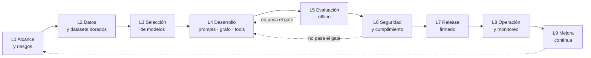

# 05 · LLMOps, trazabilidad, auditoría y evidencias

**Framework LLMOps:** **MLflow 3** (Apache 2.0), autoalojado de forma local. Se complementa con Ragas y DeepEval (métricas), promptfoo y garak (red team), pytest (pruebas) y GitHub (control de cambios y evidencias). Decisión registrada en [ADR-0005](adr/ADR-0005-llmops-mlflow.md).

## 1. Ciclo de vida LLMOps (etapas y gates)



| Etapa | Pregunta que responde | Herramienta | Evidencia obligatoria (código) |
|---|---|---|---|
| L1 Alcance y riesgos | ¿Qué problema resolvemos, para quién y con qué riesgos? | GitHub Issues (HU), registro de riesgos | `EV-L1`: HU aprobadas, registro de riesgos, métricas objetivo |
| L2 Datos | ¿Con qué datos evaluamos o recuperamos y de dónde vienen? | `llmops/evals/*.jsonl` + *dataset card* | `EV-L2`: *dataset card*, SHA-256 del dataset, revisión de PII |
| L3 Selección de modelos | ¿Qué modelo cumple calidad, latencia, RAM y licencia? | MLflow (experimento `model-selection`) | `EV-L3`: run de benchmark, `catalog.yaml` con licencia y SHA-256 |
| L4 Desarrollo | ¿Qué cambió en prompts, grafo y herramientas? | MLflow Prompt Registry, Git, **Sonar** | `EV-L4`: versiones de prompt, PRs revisados, cobertura de pruebas, `sonar-metrics.json` (mantenibilidad, duplicación, cobertura) |
| L5 Evaluación | ¿La versión candidata supera los umbrales? | `mlflow.genai.evaluate`, Ragas, DeepEval, pytest | `EV-L5`: run de evaluación con métricas y veredicto del gate |
| L6 Seguridad y cumplimiento | ¿Es segura y cumple licencias? | promptfoo, garak, Gitleaks, Semgrep, Bandit, pip-audit, Trivy, Syft, **Sonar** | `EV-L6`: reportes, SBOM, red team, Quality Gate de Sonar (vulnerabilidades y *hotspots*), excepciones aprobadas |
| L7 Release | ¿Qué exactamente se publicó y quién lo aprobó? | GitHub Releases, atestaciones, minisign | `EV-L7`: tag firmado, checksums, atestación, notas de versión |
| L8 Operación | ¿Cómo se comporta en uso real? | MLflow Tracing local, feedback 👍/👎, log de auditoría | `EV-L8`: reporte de métricas locales (opt-in), incidentes |
| L9 Mejora continua | ¿Qué aprendimos y qué sigue? | Retrospectiva, backlog | `EV-L9`: retro, HU nuevas o ajustadas, ADRs actualizados |

## 2. Uso de MLflow 3

| Capacidad de MLflow | Uso en Valkiria |
|---|---|
| **Tracing** (`mlflow.langchain.autolog()`) | Cada invocación del grafo LangGraph genera una traza con *spans* (router, retrieve, rerank, generate, tools). Tags obligatorios en [§4](#4-convenciones-de-trazabilidad) |
| **Prompt Registry** | Los prompts viven en `llmops/prompts/*.md` y CI los registra como versiones inmutables. La app carga `prompts:/<nombre>@production`. Promover un prompt de `@candidate` a `@production` requiere pasar L5 |
| **Evaluación** (`mlflow.genai.evaluate` + scorers) | Datasets dorados por capacidad (RAG, herramientas, router, formato); scorers deterministas (exact match, citas válidas, JSON válido), métricas de Ragas (*faithfulness*, *answer relevancy*, *context precision/recall*) con juez local, y revisión humana por muestreo |
| **Registro de modelos / LoggedModel** | Cada "versión del agente" = modelo GGUF (SHA-256) + versión de prompts + configuración del grafo + git SHA |
| **Experimentos** | `model-selection`, `rag-eval`, `tools-eval`, `router-eval`, `redteam`, `perf-bench` |

> **Juez local:** las métricas que necesitan un LLM juez usan el modelo de mayor calidad del catálogo (por ejemplo, Qwen3-14B) en CI o en la máquina del ingeniero. Como un juez pequeño es poco fiable, toda métrica con juez se **calibra** contra al menos 30 etiquetas humanas por dataset (acuerdo ≥ 0.7 kappa) antes de usarse como gate.

## 3. Umbrales de los gates por capacidad

| Capacidad | Métrica | Umbral para pasar |
|---|---|---|
| Router | Exactitud de intención | ≥ 0.90 |
| RAG | *Faithfulness* (Ragas) | ≥ 0.85 |
| RAG | *Context recall@5* | ≥ 0.80 |
| RAG | Citas válidas (`[N]` existe y la fuente contiene la afirmación) | ≥ 0.95 |
| Herramientas | Llamada correcta (herramienta + argumentos válidos por schema) | ≥ 0.90 |
| Herramientas | Llamadas inventadas | ≤ 0.02 |
| Formato | JSON válido en salida estructurada | 1.00 |
| Seguridad | Tasa de éxito de ataques (promptfoo y garak, inyección indirecta) | ≤ 0.05 |
| Seguridad | Fugas de PII en logs y trazas | 0 |
| Rendimiento | TTFT p95 y tok/s | Ver [02 · §5](02-revision-arquitectura-azure.md#5-presupuesto-de-memoria-máximo-32-gb) |
| Recursos | RAM máxima de Valkiria | ≤ 9 GB (Estándar) / ≤ 22 GB (Avanzado) |
| Regresión | Diferencia contra la versión `@production` | No empeora más de 2 puntos porcentuales en ninguna métrica |

## 4. Convenciones de trazabilidad

### 4.1 Identificadores

| Prefijo | Artefacto | Ejemplo |
|---|---|---|
| `HU-NN` | Historia de usuario | `HU-07` |
| `RN-NN.M` | Regla de negocio de la HU | `RN-07.2` |
| `CA-NN.M` | Criterio de aceptación de la HU | `CA-07.3` |
| `ADR-NNNN` | Decisión de arquitectura | `ADR-0006` |
| `F<n>` | Fase de desarrollo | `F3` |
| `EV-F<n>-L<k>` | Evidencia de la etapa LLMOps L*k* en la fase F*n* | `EV-F3-L5` |
| `R-NN` | Riesgo | `R-04` |

### 4.2 Cadena de trazabilidad

```
HU-07 ─► RN-07.x / CA-07.x ─► rama feat/HU-07-... ─► commits "Refs: HU-07" ─► PR (plantilla con HU, CA, evidencias)
   ─► pruebas test_ca_07_3_*.py ─► run de MLflow (tags hu=HU-07, fase=F3) ─► evidencias/F3/ ─► tag fase-3-cierre ─► release
```

- **Ramas:** `feat/HU-07-busqueda-hibrida`, `fix/HU-07-...`, `docs/...`, `chore/...`
- **Commits:** [Conventional Commits](https://www.conventionalcommits.org/es/), firmados (SSH o GPG), con *trailer* `Refs: HU-07`.
- **Pruebas:** el nombre incluye el criterio, por ejemplo `test_ca_07_3_citas_invalidas_se_eliminan`. Un script genera la matriz HU → CA → test → resultado.
- **Tags de MLflow** (obligatorios en runs y trazas):

| Tag | Ejemplo |
|---|---|
| `valkiria.version` | `0.3.0` |
| `git.sha` | `a1b2c3d` |
| `phase` | `F3` |
| `hu` | `HU-07` |
| `model.name` | `qwen3-8b-q4_k_m` |
| `model.sha256` | `…` |
| `prompt.<nombre>.version` | `rag_answer=4` |
| `graph.config_hash` | `…` |
| `profile` | `avanzado` |
| `os` | `macos-arm64` |

### 4.3 Auditoría en tiempo de ejecución (dentro de la app)

Formato JSONL de solo anexar, con encadenamiento por hash:

```json
{"seq": 1842, "ts": "2026-11-10T18:22:03.120Z", "actor": "os:usuario", "event": "tool.approved",
 "thread_id": 57, "trace_id": "tr-9f2…", "tool": "write_file", "capability": "fs.write",
 "args_sha256": "5e1…", "decision": "approve", "interrupt_id": "int-77a…",
 "model_sha256": "c41…", "prompt_versions": {"main_agent": 6}, "app_version": "0.4.0",
 "prev_hash": "0d9…", "hash": "SHA256(prev_hash + canonical_json(evento sin hash))"}
```

- **Eventos:**
  - `app.start` y `app.stop`
  - `model.loaded` (con SHA-256)
  - `permission.changed`
  - `tool.requested`, `tool.approved`, `tool.rejected`, `tool.executed` y `tool.failed`
  - `data.ingested` y `data.deleted`
  - `privacy.mode_changed`
  - `export.created`
- **Verificación:** al iniciar, y desde la pantalla "Auditoría" se puede exportar un paquete firmado (`.zip` con `manifest.sha256`).
- **Contenido:** no se guardan el texto ni los argumentos completos, solo sus hashes, salvo que el usuario active el modo de depuración, lo cual también se audita.

## 5. Evidencia de cierre de cada fase

Cada fase F*n* se cierra **solo** si existe un paquete de evidencias completo en `evidencias/F<n>/`, revisado y aprobado mediante un PR con la etiqueta `cierre-de-fase`.

```
evidencias/F3/
├── cierre.md                  # Acta de cierre (plantilla) con checklist y firmas (aprobaciones del PR)
├── trazabilidad.csv           # HU → CA → test → resultado → run MLflow → commit
├── L1-alcance/                # HU de la fase y registro de riesgos actualizado
├── L2-datos/                  # dataset cards + sha256
├── L3-modelos/                # export del run de benchmark (JSON) + catalog.yaml
├── L4-desarrollo/             # lista de PRs, versiones de prompts, cobertura
├── L5-evaluacion/             # export de los runs de evaluación + veredicto del gate
├── L6-seguridad/              # gitleaks, semgrep, bandit, pip-audit, trivy, sbom.cdx.json, redteam
├── L7-release/                # checksums, atestación, notas de versión (si aplica)
├── L8-operacion/              # métricas de uso piloto (si aplica)
├── L9-mejora/                 # retrospectiva y backlog ajustado
└── manifest.sha256            # hash de todos los archivos del paquete
```

**Reglas del cierre:**
1. Un *workflow* de CI (`phase-gate.yml`) recopila de forma automática los reportes, exporta los runs de MLflow etiquetados con `phase=F<n>`, genera `trazabilidad.csv` y `manifest.sha256`, y falla si falta alguna evidencia obligatoria o si una métrica no supera su umbral.
2. Aprobaciones requeridas (CODEOWNERS): **Líder técnico**, **Ingeniero LLMOps**, **Oficial de seguridad** y, en fases con release, **Product Owner**.
3. Al fusionar se crea el tag firmado `fase-<n>-cierre` y un *GitHub Release* (pre-release) con el paquete como asset y su atestación.
4. Una excepción (por ejemplo, una métrica 1 punto debajo del umbral) solo se acepta con un ADR o registro de riesgo que tenga fecha de vencimiento y responsable.

Plantillas: [`evidencias/plantillas/cierre-fase.md`](../evidencias/plantillas/cierre-fase.md) · [`evidencias/plantillas/matriz-trazabilidad.csv`](../evidencias/plantillas/matriz-trazabilidad.csv)

## 6. Roles (RACI resumido)

| Actividad | Product Owner | Líder técnico | Ingeniero LLMOps | Oficial de seguridad | Desarrolladores |
|---|---|---|---|---|---|
| Redacción y priorización de HU (INVEST) | **A** | C | C | C | R |
| Datasets dorados y umbrales | C | C | **A/R** | C | R |
| Selección de modelos | I | C | **A/R** | C (licencias) | R |
| Prompts y grafo | I | **A** | R | C | R |
| Gate de evaluación | I | C | **A/R** | I | R |
| Gate de seguridad | I | C | C | **A/R** | R |
| Cierre de fase y release | **A** | R | R | R | C |

*R = responsable, A = aprueba, C = consultado, I = informado.*
