# 06 · Plan de desarrollo incremental (v2)

Esta versión 2 sustituye al plan basado en Tauri y Rust. Ahora el plan se basa en:
- el **fork de Jan** como frontend,
- **Valkiria Core en Python 3.15** con LangGraph y LangChain v1,
- **MLflow 3** para LLMOps,
- **mini LLMs gratuitos**, con un **máximo de 32 GB de RAM**,
- builds para **macOS y Windows**.

Las historias de usuario de cada fase están en [07 · Historias de usuario](07-historias-usuario.md). El proceso de cierre y sus evidencias se describen en [05 · LLMOps](05-llmops-trazabilidad.md#5-evidencia-de-cierre-de-cada-fase).

## 1. Hoja de ruta

```mermaid
gantt
    title Valkiria Productividad: hoja de ruta (semanas)
    dateFormat  X
    axisFormat  S%s
    section Base
    F0 Fundaciones y gobierno        :f0, 0, 2
    F1 Inferencia y modelos          :f1, after f0, 2
    F2 Valkiria Core                 :f2, after f1, 2
    section Capacidades
    F3 Ingesta y RAG                 :f3, after f2, 3
    F4 Tools, MCP, permisos, auditoría :f4, after f3, 3
    F5 Guardrails y red team         :f5, after f4, 2
    F6 Skills y Office               :f6, after f5, 2
    F7 Proyectos                     :f7, after f6, 1.5
    F8 Multimodal y voz              :f8, after f7, 2
    F9 Automatización                :f9, after f8, 1.5
    section Entrega
    F10 Release y operación          :f10, after f9, 2
    F11 Modo equipo (opcional)       :f11, after f10, 3
```

Duración estimada: unas **23 semanas** hasta la versión 1.0 (F0 a F10), con un equipo de 3 a 4 personas. F11 es opcional.

## 2. Resumen por fase

| Fase | Objetivo | HU | Etapas LLMOps con gate | Release |
|---|---|---|---|---|
| F0 | Repositorio, CI seguro en macOS y Windows, Sonar, MLflow, fork de Jan con marca Valkiria | HU-01, HU-02, HU-03, HU-29 | L1, L4, L6 | `0.0.x` interno |
| F1 | Inferencia local con un catálogo de mini LLMs verificados y elegidos con datos | HU-04, HU-05, HU-06 | L2, L3, L5, L6 | `0.1.0` |
| F2 | Sidecar Python seguro y supervisado, con chat del agente, historial y trazas | HU-07, HU-08, HU-09 | L4, L5, L6 | `0.2.0` |
| F3 | Ingesta de documentos, RAG híbrido con citas y derecho al olvido | HU-10, HU-11, HU-12 | L2, L4, L5, L6 | `0.3.0` |
| F4 | Herramientas MCP, router, permisos de tres niveles con HITL y auditoría encadenada | HU-13, HU-14, HU-15, HU-16 | L4, L5, L6 | `0.4.0` |
| F5 | Guardrails, privacidad y red teaming automatizado | HU-17, HU-18, HU-19 | L5, L6 | `0.5.0` |
| F6 | Skills y creación de documentos Office | HU-20, HU-21 | L4, L5, L6 | `0.6.0` |
| F7 | Proyectos aislados con personalidad y banco de archivos | HU-22 | L4, L5, L6 | `0.7.0` |
| F8 | Visión y OCR; dictado por voz | HU-23, HU-24 | L3, L5, L6 | `0.8.0` |
| F9 | Tareas programadas | HU-25 | L4, L5, L6 | `0.9.0` |
| F10 | Instaladores firmados, actualizaciones, feedback y métricas locales; piloto | HU-26, HU-27 | L6, L7, L8, L9 | **`1.0.0`** |
| F11 | Despliegue en modo equipo (contenedores) | HU-28 | L6, L7, L8 | `1.1.0` |

Todas las fases cierran con L1 (HU de la fase aprobadas) y L9 (retrospectiva). Ninguna fase empieza si la anterior no tiene su tag `fase-<n>-cierre`, salvo trabajo exploratorio (*spikes*) acotado.

## 3. Detalle por fase

### F0 · Fundaciones y gobierno (2 semanas)

**Alcance:**
- **Monorepo:** `apps/desktop`, `core`, `llmops`, `docs` y `evidencias`.
- **Fork de Jan v0.8.x** como *git subtree*:
  - Cambio de marca a Valkiria Productividad: nombre, ícono, *bundle id* `com.valtre.valkiria`, sitio de ayuda.
  - Se conservan `LICENSE` y `NOTICE` (Apache 2.0, con atribución a Menlo Research).
  - Se desactivan los proveedores remotos de la nube por defecto.
- **Core:** Python 3.15 gestionado con `uv` (`requires-python = ">=3.15"`), `ruff`, `mypy --strict`, `pytest`.
- **CI (GitHub Actions)** con matriz `macos-15 (arm64)`, `macos-15-intel (x64)` y `windows-2022`, que corre (GitHub retiró `macos-13` y `macos-14`):
  - lint, pruebas y build;
  - Gitleaks, Semgrep, Bandit, pip-audit, Trivy y Syft;
  - OpenSSF Scorecard.
- **Sonar** ([08](08-calidad-sonar.md), HU-29): SonarQube Cloud como Quality Gate requerido en los PRs y SonarQube Community local para el análisis previo al push.
- **MLflow 3** local (`mlflow server --backend-store-uri sqlite:///mlflow.db`), con los experimentos base y los tags obligatorios.
- **Gobierno del repositorio:** ADR-0001 a 0012, plantillas de PR, HU y cierre de fase, CODEOWNERS, ramas protegidas y commits firmados.

**Criterio de salida:**
- La app con la marca Valkiria se compila y abre en macOS y Windows desde CI.
- Todos los escaneos pasan.
- El primer paquete `evidencias/F0` se genera de forma automática.

### F1 · Inferencia local y selección de modelos (2 semanas)

**Alcance:**
- `llmops/models/catalog.yaml`: modelo, URL, SHA-256, licencia, perfil y RAM estimada.
- Descarga verificada desde la UI de Jan restringida al catálogo.
- Detección del perfil de hardware: Estándar (≤ 16 GB) o Avanzado (≤ 32 GB); y el backend de aceleración (Metal, MLX, CUDA, Vulkan o CPU).
- Dataset dorado v1, con 150 casos en español: chat, extracción, razonamiento corto y JSON.
- Benchmark de calidad, TTFT, tok/s y RAM en el experimento `model-selection`.
- Selección del modelo principal y del router por perfil (ADR-0011 actualizado).

**Criterio de salida:**
- Hay un modelo por perfil que cumple los umbrales de [02 · §5](02-revision-arquitectura-azure.md#5-presupuesto-de-memoria-máximo-32-gb).
- Ningún modelo fuera del catálogo se puede cargar.

### F2 · Valkiria Core (2 semanas)

**Alcance:**
- FastAPI como sidecar empaquetado con PyInstaller *onedir* y firmado.
- Supervisión desde Tauri: health checks y reinicio con *backoff*.
- Escucha en `127.0.0.1` con puerto efímero y bearer por sesión.
- `/v1/chat/completions` compatible con OpenAI que invoca un grafo LangGraph mínimo:
  - `ChatOpenAI` apuntando a Jan `:1337`,
  - checkpointer SQLite,
  - `SummarizationMiddleware`.
- La extensión `valkiria-extension` registra el proveedor "Valkiria Agent".
- Persistencia (SQLAlchemy y Alembic), tracing con MLflow (`autolog` y tags) y primeros prompts en el Prompt Registry.

**Criterio de salida:**
- Si se mata el proceso de Core, se reinicia en ≤ 3 s y la conversación continúa.
- Las trazas tienen todos los tags.
- La evaluación de formato da 1.00.

### F3 · Ingesta y RAG (3 semanas)

**Alcance:**
- Carpetas vigiladas (`watchfiles`).
- Docling para PDF, DOCX, XLSX, PPTX, HTML y MD.
- `RecursiveCharacterTextSplitter` por tokens: 512 tokens con 64 de traslape, guardando la página y la sección.
- Embeddings con fastembed (e5-small o bge-m3 según el perfil).
- LanceDB con búsqueda híbrida (vector + FTS) con RRF, y re-ranker en el perfil Avanzado.
- Generación con citas validadas.
- Dataset dorado de RAG v1, con 100 preguntas sobre un corpus sintético de VALTRE sin datos reales.
- Eliminación en cascada (derecho al olvido).

**Criterio de salida:** se cumplen los umbrales de RAG de [05 · §3](05-llmops-trazabilidad.md#3-umbrales-de-los-gates-por-capacidad).

### F4 · Herramientas, MCP, router, permisos y auditoría (3 semanas)

**Alcance:**
- Servidor MCP Valkiria (FastMCP, stdio) con herramientas de archivos: listar, leer, buscar, escribir y editar con diff, todo dentro de un sandbox de rutas.
- `langchain-mcp-adapters` para que el agente use esas herramientas.
- Router de intención con un modelo pequeño y salida JSON schema.
- Prompt modular de menos de 2 K tokens.
- Permisos de tres niveles con `HumanInTheLoopMiddleware` y tarjetas de confirmación en la extensión.
- Log de auditoría encadenado por hash con su visor y exportación firmada.

**Criterio de salida:**
- Se cumplen los umbrales de router y de herramientas.
- Si se manipula el log, se detecta.

### F5 · Guardrails, privacidad y red teaming (2 semanas)

**Alcance:**
- LLM Guard para entrada y salida (inyección y toxicidad), y marcado de contenido no confiable.
- Presidio con reconocedores en español (RFC, CURP, teléfonos y correos).
- Modo privacidad en las trazas.
- promptfoo con los plugins del OWASP LLM Top 10 y garak, ambos en CI.
- Modelo guardián opcional.

**Criterio de salida:**
- La tasa de éxito de los ataques es ≤ 0.05.
- Hay 0 fugas de PII en logs y trazas.

### F6 · Skills y documentos Office (2 semanas)

**Alcance:**
- Cargador de skills (`SKILL.md` con `name`, `description` y `allowed-tools`).
- Herramientas Office en Python: python-docx, openpyxl y python-pptx, ejecutadas en un proceso separado con límites de recursos.
- Vista previa en el chat.
- Skill `crear-skill`.
- Acciones rápidas.

**Criterio de salida:** la evaluación de generación de Office (schema y contenido) da ≥ 0.90.

### F7 · Proyectos (1.5 semanas)

**Alcance:**
- Cada proyecto tiene su personalidad (versionada como prompt), banco de archivos aislado con filtro `project_id` obligatorio, y skills asignadas.
- Exportar e importar proyectos (`.zip` firmado).

**Criterio de salida:** la prueba de aislamiento entre proyectos da 0 fugas.

### F8 · Multimodal y voz (2 semanas)

**Alcance:**
- Qwen3-VL bajo demanda para imágenes y PDFs escaneados por tramos, con política de un solo modelo grande cargado.
- RapidOCR como respaldo.
- Dictado con whisper.cpp (`large-v3-turbo` en el perfil Avanzado y `small` en el Estándar).

**Criterio de salida:**
- CER de OCR ≤ 5 % sobre el dataset de escaneos.
- WER de dictado en español ≤ 12 %.
- La RAM máxima se mantiene dentro del perfil.

### F9 · Automatización (1.5 semanas)

**Alcance:**
- APScheduler 4 con almacén SQLite: cron, zona horaria y un hilo por tarea.
- Notificaciones del SO.
- Política: las tareas programadas **no** pueden ejecutar herramientas con nivel `ask` sin una aprobación previa explícita y registrada.

**Criterio de salida:** 100 ejecuciones simuladas sin pérdidas, con reintentos y auditoría.

### F10 · Release y operación: versión 1.0 (2 semanas)

**Alcance:**
- Notarización en macOS y Authenticode en Windows.
- Updater de Tauri con minisign desde GitHub Releases.
- Atestaciones SLSA y SBOM adjunto.
- Feedback 👍/👎 vinculado al `trace_id`.
- Panel de métricas locales.
- Piloto con 10 a 20 colaboradores de VALTRE y su retrospectiva.

**Criterio de salida:**
- Release `1.0.0` firmado y verificable.
- Satisfacción del piloto ≥ 4/5.
- 0 incidentes de severidad alta abiertos.

### F11 · Modo equipo (opcional, 3 semanas)

**Alcance:**
- Imágenes OCI de Valkiria Core con los adaptadores de servidor: vLLM, Qdrant o pgvector, PostgreSQL, Keycloak, OpenBao y MLflow server.
- Docker Compose y Helm para k3s.

**Criterio de salida:** la prueba de carga con 25 usuarios concurrentes da p95 de TTFT ≤ 3 s con una GPU de 24 GB.

## 4. Definition of Ready (DoR) de una HU

- Cumple **INVEST**: se escribió el borrador, se analizó con INVEST y se publicó la versión mejorada en [07](07-historias-usuario.md).
- Tiene reglas de negocio numeradas (`RN-NN.M`) y criterios de aceptación en Gherkin (`CA-NN.M`).
- Si la HU toca un LLM, tiene un dataset de evaluación y un umbral definidos.
- Dependencias identificadas; tamaño de 8 puntos o menos.

## 5. Definition of Done (DoD) de una HU

- El código está fusionado por PR con la plantilla completa (HU, CA y evidencias), con al menos 1 revisión y CI en verde en macOS y Windows.
- Hay pruebas automatizadas por cada CA (`test_ca_NN_M_*`); la cobertura de Core es ≥ 85 % en las líneas nuevas.
- Si aplica, el run de evaluación de MLflow está etiquetado (`hu`, `phase`, `git.sha`) y supera el gate.
- Los escaneos de seguridad no tienen hallazgos de severidad alta y el **Quality Gate de Sonar** está en verde.
- La documentación y los ADRs están actualizados y la HU aparece en `trazabilidad.csv`.

## 6. Registro de riesgos (inicial)

| ID | Riesgo | Prob. | Impacto | Mitigación | Responsable |
|---|---|---|---|---|---|
| R-01 | Dependencias críticas (onnxruntime, lancedb, docling, pyinstaller) sin *wheels* para Python 3.15 en Windows o macOS | Media | Alto | *Spike* en F0; matriz de CI 3.15; contingencia temporal en 3.14 documentada en ADR-0002 con fecha de vencimiento | Líder técnico |
| R-02 | Uso de herramientas poco fiable en modelos de 4 a 8 B | Alta | Alto | Router, JSON schema, pocas herramientas, gate en F4 | Ingeniero LLMOps |
| R-03 | Cambios en Jan upstream que rompen el fork | Media | Medio | *Subtree* con sincronización trimestral; la lógica propia vive en la extensión, no en el núcleo de Jan | Líder técnico |
| R-04 | Falsos positivos del antivirus por el sidecar de PyInstaller | Media | Medio | Firma Authenticode; *onedir*; envío a Microsoft para análisis | DevOps |
| R-05 | RAM insuficiente en el perfil Estándar | Media | Medio | Política de un solo modelo grande; KV en q8; contexto de 8 K | Ingeniero LLMOps |
| R-06 | Juez LLM local poco fiable | Alta | Medio | Calibración humana (kappa ≥ 0.7) y métricas deterministas como base | Ingeniero LLMOps |
| R-07 | Licencias de modelos que cambian | Baja | Alto | Revisión del catálogo en cada cierre; solo Apache 2.0 o MIT por defecto | Oficial de seguridad |
| R-08 | Repositorio privado en plan Free: sin reglas de protección de ramas y minutos de macOS multiplicados ×10 | — | — | **Cerrado el 2026-11-11:** los minutos se agotaron durante F0 y el repositorio se hizo público (D1). *Ruleset* `main` con PR obligatorio y checks requeridos | Líder técnico |
| R-09 | Faltan los recursos de marca oficiales de VALTRE (ícono y textos) | Media | Bajo | Ícono provisional generado en el repo; se reemplaza sin cambiar código | Product Owner |
| R-10 | El código propio supera el límite de líneas del plan Free de SonarQube Cloud | Baja | Medio | Alerta al 80 % en `export-metrics.sh` (RN-29.6) | Líder técnico |
| R-11 | onnxruntime sin *wheels* para Python 3.15 (spike de F0) | Alta | Alto | Contingencia 3.14 por plataforma (ADR-0002) o *embedder* alternativo; vence con la primera versión `cp315` | Ingeniero LLMOps |
| R-12 | Sin *wheels* para macOS x64 de lancedb, torch y onnxruntime | Alta | Alto | Decisión del Product Owner antes de F3 (ver ADR-0002) | Product Owner |
| R-13 | Jan v0.8.8 traía ~100 CVE altas o críticas en dependencias de terceros. El 2026-11-11 se redujeron a 6 hallazgos (4 CVE) con *resolutions* de yarn, la limpieza de dependencias sin uso y `quinn-proto` 0.11.15. Quedan `zip` (Rust, exige tauri 2.12+ y calamine 0.37) y `tinypool` (solo pruebas) | Media | Medio | Reporte en cada CI; excepción EX-003 acotada hasta el 2026-12-31; en F1, subir zip a 9 junto con tauri, tauri-plugin-updater y calamine | Oficial de seguridad |
